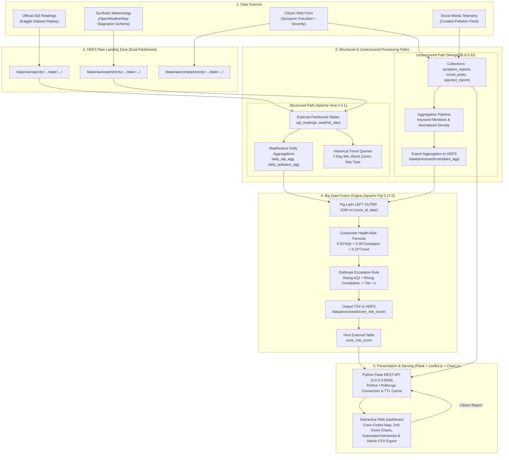

# Multi-City Air Quality & Public Health Early-Warning System

**Course:** 21MDS56 – Big Data Computing Laboratory  
**Degree Program:** M.Sc Data Science  
**Institution:** Coimbatore Institute of Technology (CIT), Coimbatore  
**Author:** Senior Big-Data Engineer  
**Host Environment:** Native Cluster on WSL2 Ubuntu 24.04 LTS (Hadoop 3.3.6, Hive 4.0.1, Pig 0.17.0, MongoDB 8.0.32, Python 3.12) / Docker Compose Compatible  

---

## 1. Executive Summary & Core Idea

Urban air pollution monitoring has traditionally focused purely on physical air quality metrics (ambient AQI, $PM_{2.5}$, $PM_{10}$). However, physical metrics alone cannot detect clinical morbidity variations or distinguish between toxic biological threats and localized benign dust (such as construction debris).

The **Multi-City Air Quality & Public Health Early-Warning System** combines:
1. **Official AQI + meteorological readings** (CPCB real data from Kaggle + synthetic weather).
2. **Citizen-reported symptoms and complaints** (interactive web form + synthetic seed data).

Both streams land in an HDFS raw data lake, are processed through Hive and MongoDB, and are joined by **ZONE** and **DATE** using **Apache Pig** on MapReduce to compute a near real-time **Composite Health-Risk Score (0–100)** per zone. The system issues color-coded alerts (`GREEN`, `YELLOW`, `ORANGE`, `RED`) and plain-language clinical advisories. 

> **Key System Behavior:** Detect serious public health situations when rising air pollution coincides with rising symptom reports in the same zone, rather than relying on high ambient AQI alone.

---

## 2. System Architecture Diagram



---

## 3. Technology Stack

- **Distributed File System (HDFS):** Apache Hadoop 3.3.6 raw landing zone partitioned by `city` and `date`.
- **Structured Data Warehouse (Hive):** Apache Hive 4.0.1 external tables with partition pruning, MapReduce aggregations, and window functions.
- **Unstructured Document Store (MongoDB):** MongoDB 8.0.32 document store for symptom reports, text keyword analytics, and audit logs.
- **Big Data Fusion Engine (Pig):** Apache Pig 0.17.0 running on MapReduce (`pig -x mapreduce`).
- **Ingestion Workers:** Python 3.12 scheduled batch scripts with atomic HDFS putting.
- **Serving Backend:** Python Flask with sub-millisecond in-memory cache and CSV export fallback.
- **Frontend Presentation:** HTML5, CSS3, Bootstrap 5, Leaflet.js interactive maps, Chart.js multi-axis charts.
- **Scheduling:** Standard crontab pipeline scheduler + Apache Oozie `workflow.xml` and `coordinator.xml`.
- **Containerization:** Production `docker-compose.yml` for portable multi-service container deployment.

---

## 4. Health Risk Formula & Outbreak Escalation Rule

The composite health-risk score ($0 - 100$) per zone and date is computed inside Apache Pig:

$$\text{aqi\_score} = \min\left(\frac{\text{avg\_aqi}}{500.0}, 1.0\right) \times 100.0$$

$$\text{complaint\_score} = \min(\text{complaint\_density\_normalized}, 1.0) \times 100.0$$

$$\text{trend\_score} = \text{scaled 3-day rise in AQI and complaints (0–100)}$$

$$\mathbf{Composite\ Risk\ Score} = 0.50 \times \text{aqi\_score} + 0.35 \times \text{complaint\_score} + 0.15 \times \text{trend\_score}$$

### Risk Tiers
- **GREEN (0 – 24.99):** Low Risk / Safe Air.
- **YELLOW (25.0 – 49.99):** Moderate Alert (sensitive groups should monitor symptoms).
- **ORANGE (50.0 – 74.99):** High Health Advisory (limit outdoor activities; hospital preparedness).
- **RED (75.0 – 100.0):** Severe Emergency (mask mandates, hospital surge protocols, school closures).

### Outbreak Escalation Rule
$$\text{If } \text{aqi\_score} \ge 50.0 \text{ AND } \text{complaint\_score} \ge 40.0 \text{ in the same zone} \implies \text{Raise Alert Level by 1 Tier (Capped at RED)}$$
- $\text{GREEN} \to \text{YELLOW}$
- $\text{YELLOW} \to \text{ORANGE}$
- $\text{ORANGE} \to \text{RED}$
- $\text{RED} \to \text{RED}$

Both `base_level` (before escalation), `final_level` (after escalation), and the boolean flag `escalated` are recorded.

---

## 5. Synthetic Data Disclosure & Real Dataset Attribution

1. **Real Data Attribution:**
   - Real air quality telemetry is exclusively sourced from [Rohan Rao's Kaggle Dataset: Air Quality Data in India (2015–2020)](https://www.kaggle.com/datasets/rohanrao/air-quality-data-in-india).
   - Extracted in `data/raw/` (`stations.csv`, `station_hour.csv`, `station_day.csv`, `city_hour.csv`, `city_day.csv`).
2. **Synthetic Data Disclosure:**
   - Zone coordinates (`data/synthetic/zones.csv`), meteorological conditions (`data/synthetic/weather.csv`), citizen symptom complaints (`data/synthetic/symptom_reports.json`), and social media feeds (`data/synthetic/social_posts.json`) are synthetic, deterministically generated using `generators/generate_synthetic.py` (fixed seed = 42).
   - All synthetic records are explicitly labeled with `source: "synthetic"`, as noted on the dashboard footer.
3. **Simulated Component Stand-ins:**
   - `ingestion/aqi_ingest.py` stands in for **CPCB / OpenAQ REST API**.
   - `ingestion/weather_ingest.py` stands in for **OpenWeatherMap API**.
   - `generators/generate_synthetic.py` stands in for **Twitter / X Firehose**.
   - `backend/app.py` (`POST /api/complaints`) stands in for the **Citizen Health Hotline / Web Portal**.

---

## 6. Demo in 5 Minutes (Lab Viva Guide)

Follow this 5-minute walkthrough during your lab viva evaluation:

```bash
# Step 1: Verify all Big Data cluster services are healthy
./scripts/status.sh

# Step 2: Show HDFS raw partitioned landing zone (155 partitions)
hdfs dfs -ls /data/raw/aqi/city=Coimbatore | head -n 6
hdfs dfs -ls /data/raw/complaints/city=Coimbatore | head -n 6

# Step 3: Run the end-to-end Big Data pipeline
./scripts/run_pipeline.sh

# Step 4: Show Pig fusion risk score output proving Outbreak vs Decoy cases
# Outbreak case: CBE_ZN_01 reaches 90.02 (RED, escalated=true)
# Decoy case: BOM_ZN_01 has high AQI (266) but 0 complaints, staying at 39.43 (YELLOW, escalated=false)
hdfs dfs -cat /data/processed/zone_risk_score/* | grep 'CBE_ZN_01' | tail -n 2
hdfs dfs -cat /data/processed/zone_risk_score/* | grep 'BOM_ZN_01' | head -n 2

# Step 5: Execute and show Hive 5 analytical trend queries
bash scripts/run_hive_queries.sh
cat docs/hive_queries_output.txt | tail -n 25

# Step 6: Verify MongoDB unstructured collections & keyword analytics
./venv/bin/python3 scripts/verify_mongo.py

# Step 7: Demonstrate live citizen report intake & score impact
./venv/bin/python3 scripts/verify_complaint_pipeline.py

# Step 8: Run the automated pytest suite (All 28 tests passing)
./venv/bin/pytest tests/ -v
```

### Access the Web Interfaces:
- **Surveillance Map & Dashboard:** `http://localhost:5000`
- **Hive Trend Analytics Page:** `http://localhost:5000/trends`
- **Citizen "Check My Area" Portal:** `http://localhost:5000/check`
- **Pipeline Status Monitor:** `http://localhost:5000/status`
- **Alert Notifications Feed:** `http://localhost:5000/alerts`
- **Municipal Administrative Console:** `http://localhost:5000/admin` (Credentials: `admin` / `admin123`)

---

## 7. Future Scope & Machine Learning Roadmap

In strict accordance with the project guidelines, this version does **not** employ machine learning or black-box predictive models, relying entirely on transparent big-data MapReduce aggregations, statistical Z-scores, and deterministic multi-criteria decision fusion.

Planned future extensions include:
1. **Spatio-Temporal Graph Neural Networks (GNNs):** Predicting pollutant dispersion across contiguous municipal zones using Graph Convolutional Networks (GCN) combined with wind vector graphs.
2. **Transformer-Based NLP (BioBERT / ClinicalBERT):** Real-time symptom extraction and clinical entity recognition from noisy, unstructured multilingual vernacular social media posts (Tamil, Hindi, English).
3. **Deep Sequence AQI Forecasting (LSTM / PatchTST):** High-resolution 72-hour air quality sequence prediction integrating micro-climate satellite imagery and vehicular traffic mobility feeds.
4. **Automated Epidemiological Causal Inference:** Estimating the causal effect of emergency traffic rationing schemes (such as odd-even policies) on pediatric respiratory hospital admissions.
